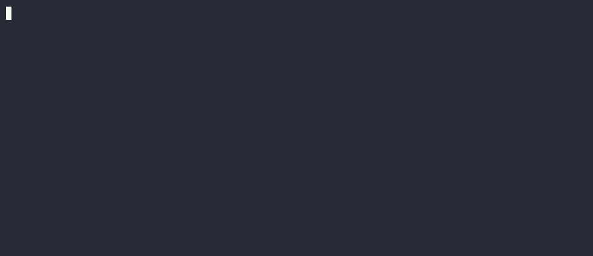
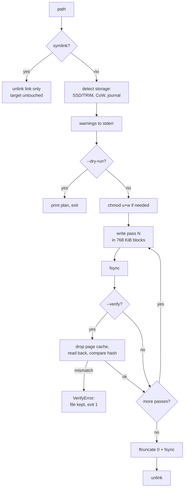

```text
   ____ _   _ _____ _____ __  __    _    _   _
  / ___| | | |_   _|_   _|  \/  |  / \  | \ | |
 | |  _| | | | | |   | | | |\/| | / _ \ |  \| |
 | |_| | |_| | | |   | | | |  | |/ ___ \| |\  |
  \____|\___/  |_|   |_| |_|  |_/_/   \_\_| \_|
        secure file shredder · DoD 5220.22-M · 35-pass
```

[](https://github.com/DakodaStemen/Guttman/actions/workflows/ci.yml)
[](https://www.python.org)
[](LICENSE)

Overwrites a file with fixed and random patterns, **optionally reads every pass back to prove it landed**, then unlinks it. Pure standard library. Warns you when your storage makes overwriting unreliable.



> The demo shreds a temp file created by the script ([`docs/demo.sh`](docs/demo.sh)); nothing else is touched.

> [!NOTE]
> **Spelling:** the project is called *Guttman* but the method is named after cryptographer Peter **Gutmann** (one *t*, one *n* at the end). The CLI flag is `--method gutmann`, matching the paper. The repo name is kept as-is.

## Install

```bash
pip install git+https://github.com/DakodaStemen/Guttman.git   # gives you the `guttman` command
# or from a checkout
pip install -e ".[test]"
```

Python 3.10+, Linux. No runtime dependencies.

## Usage

```bash
guttman secret.txt                      # DoD 3-pass
guttman --verify secret.txt             # + read back every pass
guttman -n -m gutmann -r ./private/     # dry run: show plan and warnings, change nothing
guttman -m gutmann --verify -r ./private/
guttman -m random -p 10 key.pem
python -m guttman --help
```

| Option | Meaning |
|---|---|
| `-m {dod,gutmann,random}` | method (default `dod`) |
| `-p N` | pass count for `random` |
| `--verify` | read back each pass (random included) and compare |
| `-n`, `--dry-run` | report what would happen; modify nothing |
| `--progress / --no-progress` | progress bar on stderr (default: on when stderr is a TTY) |
| `-q` | silence storage warnings |
| `-r` | recurse into directories |
| `-v` | per-pass logging |

Exit codes: `0` ok, `1` any failure (including verify mismatch), `130` interrupted.

## Pipeline



## Methods

| Method | Passes | Sequence |
|---|---|---|
| `dod` | 3 | `0x00`, `0xFF`, random |
| `gutmann` | 35 | 4 random, 27 fixed patterns from the 1996 paper, 4 random |
| `random` | N | N random passes (`os.urandom`) |

> [!NOTE]
> The Gutmann fixed patterns target MFM/RLL-era encodings. On modern drives they add time, not security (Gutmann says so in the paper's 2003 epilogue). DoD 5220.22-M is likewise superseded by NIST SP 800-88 for current media.

## Verification

With `--verify`, after each pass the file is `fsync`ed, its page cache is dropped with `posix_fadvise(DONTNEED)`, and it is read back and compared to a BLAKE2b digest computed while writing. That works for random passes too, without storing the random data. A mismatch raises `VerifyError`, the file is **not** unlinked, and the exit code is 1.

> [!WARNING]
> Read-back confirms what the *OS/device returns*. A drive's write cache or a remapping layer can still answer from somewhere other than the original location. It catches I/O errors and silent corruption, not remapping.

## Storage warnings

Guttman checks the mount (`/proc/self/mountinfo`) and block device (`/sys`) under each target and warns about:

- **SSD / NVMe** (`queue/rotational = 0`), noting whether TRIM (`discard_max_bytes > 0`) is available. Resolves partitions and device-mapper/LVM stacks.
- **Copy-on-write / log-structured**: btrfs, ZFS, bcachefs, f2fs, nilfs2.
- **Journaling**: ext3/4 `data=journal` (warning: data is in the journal); metadata journals on ext4/xfs/jfs/ntfs (note).
- **Layered, RAM, network**: overlayfs, tmpfs, NFS, CIFS, FUSE.

## Threat model

> [!CAUTION]
> **SSDs and flash:** wear-levelling remaps logical blocks. Overwriting block *N* may program a different cell and leave the old one intact. TRIM tells the drive space is free; it is not a secure erase.

> [!CAUTION]
> **Copy-on-write filesystems (btrfs, ZFS):** writes allocate new blocks. The old data stays in free space or in snapshots.

> [!WARNING]
> **Journals, snapshots, backups, caches:** copies made elsewhere (ext4 `data=journal`, LVM/btrfs/ZFS snapshots, backups, thumbnails, swap, editor temp files) are out of reach.

> [!IMPORTANT]
> Detection is heuristic. **No warning is not a guarantee.** For flash, CoW or unknown storage, use full-disk encryption from the start and destroy the key (or use the device's ATA Secure Erase / NVMe Sanitize for whole-drive wipes).

Behavioral notes:
- **Symlinks** are removed, never followed. The target is left alone.
- **Hard links:** all names see the overwritten data; a warning is printed.
- **Read-only files** are made owner-writable, then shredded.
- **Interrupted shreds** (Ctrl-C, power loss) leave indeterminate content. Do not treat as deleted; re-run.
- **Directories** are walked bottom-up; each file is shredded, then the empty directory is removed. Failures are counted and reflected in the exit code.

## Benchmarks

Measured with [`benchmarks/bench.py`](benchmarks/bench.py): one 64 MiB temp file per run, median of 3, `fsync` after every pass, includes the final unlink.

Environment: AMD Ryzen 7 5800H, Linux 7.0 x86_64, Python 3.14.7, ext4 on LVM over NVMe.

| Method | Passes | Median time | Effective MiB/s | Raw write MiB/s |
|---|---|---|---|---|
| dod | 3 | 1.77 s | 36 | 108 |
| dod + verify | 3 | 2.27 s | 28 | 84 |
| random x3 | 3 | 3.11 s | 21 | 62 |
| gutmann | 35 | 14.46 s | 4 | 155 |
| gutmann + verify | 35 | 27.43 s | 2 | 82 |

*Effective* = file size / wall time. *Raw* = bytes written (size x passes) / wall time. These come from a single machine and are noisy (fsync latency dominates the small-file numbers; the `random` row is bounded by `os.urandom`). Re-run `python benchmarks/bench.py` on your hardware.

## Development

```bash
pip install -e ".[test]"
python -m pytest
python benchmarks/bench.py --size-mib 64 --runs 3
```

```text
guttman/
├── cli.py        argument parsing, orchestration
├── shredder.py   write/verify loop, dry-run, directory walk
├── patterns.py   DoD / Gutmann / random sequences
├── detect.py     SSD/TRIM, CoW, journal detection
└── progress.py   progress bar
tests/            pytest suite (patterns, shredding, verify, dry-run, detection)
benchmarks/       throughput measurement
docs/             demo.gif + demo.sh
```

## License

MIT, see [LICENSE](LICENSE). Copyright (c) 2021-2026 Dakoda Stemen.
